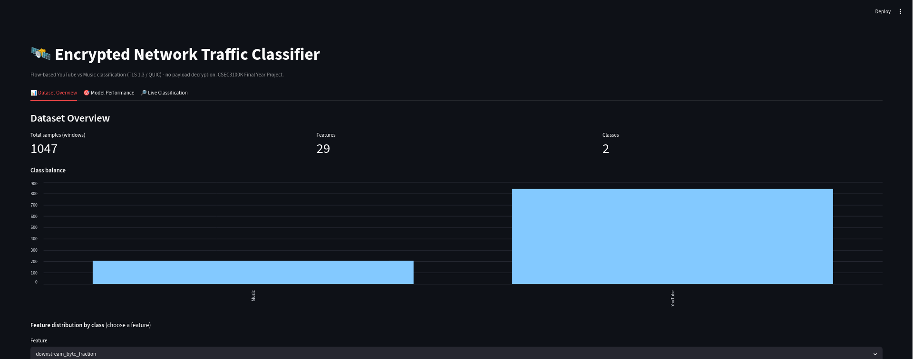
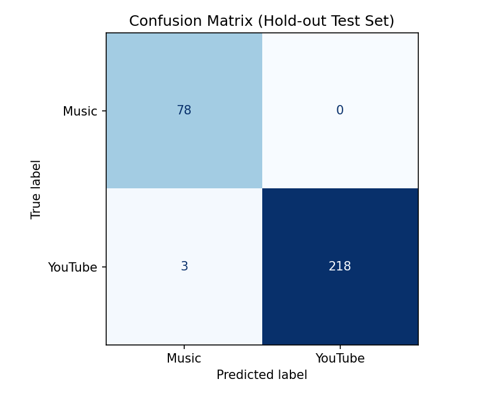
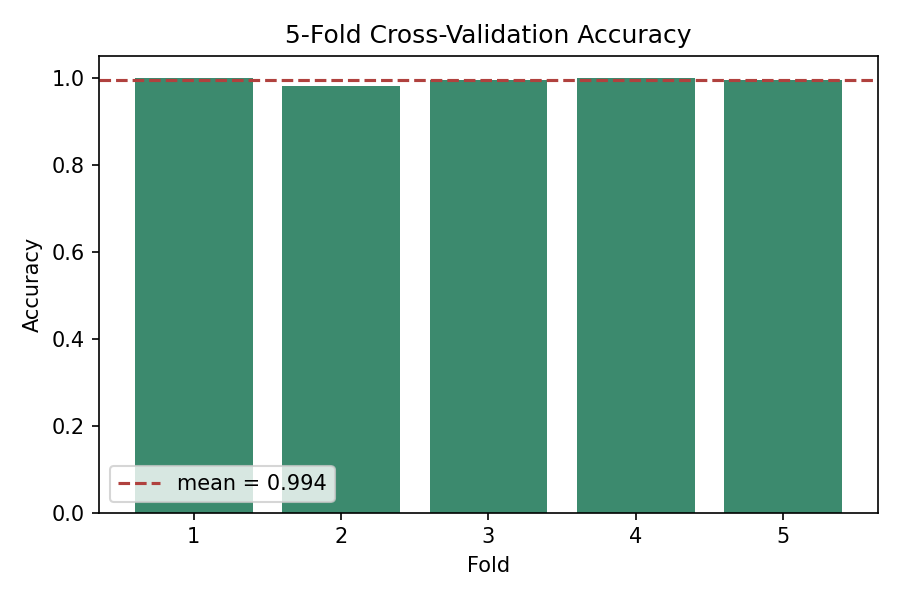
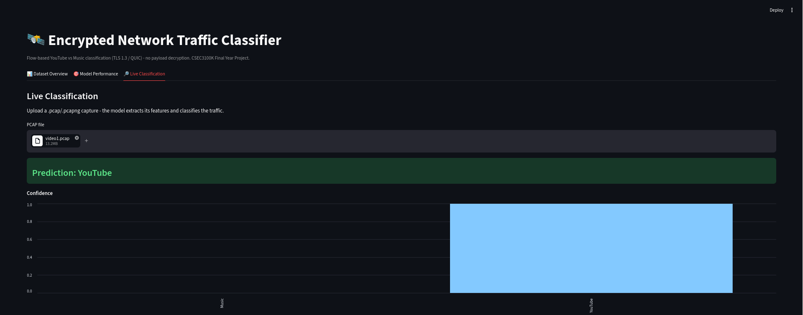
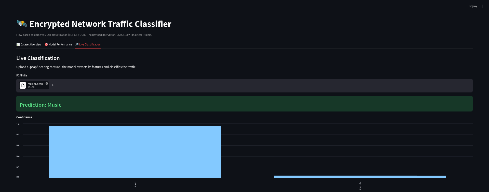
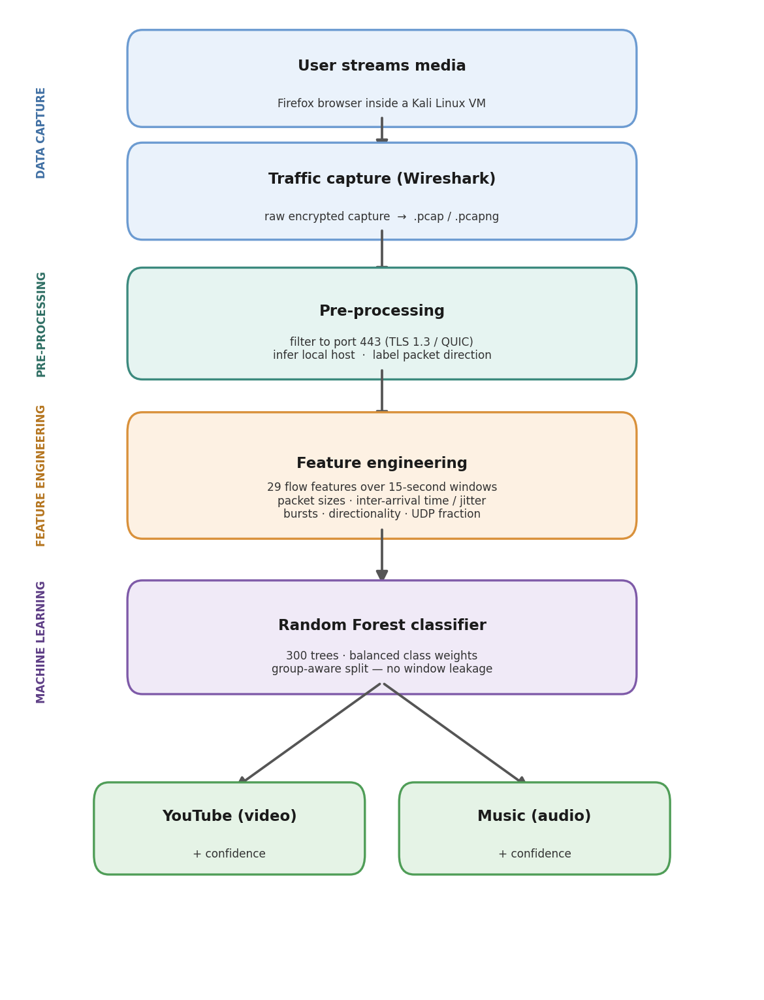
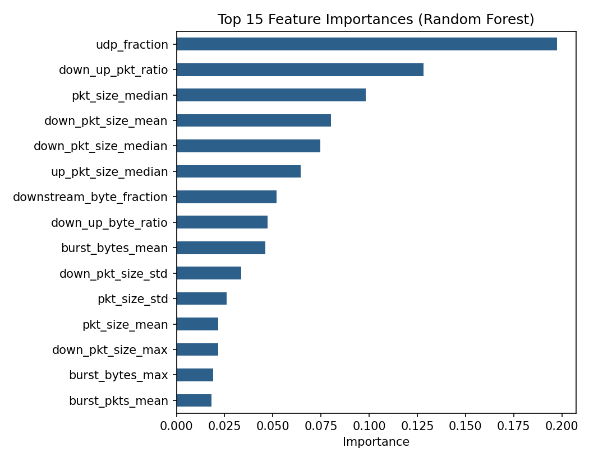

# Encrypted Network Traffic Classifier

Machine-learning classification of **encrypted** multimedia traffic (TLS 1.3 / QUIC) into **video (YouTube)** vs **audio (music streaming)** — using only flow-level metadata (packet sizes, timing, direction). **No payload decryption, no SNI.**

> Final Year Project — BSc Cyber Security, De Montfort University Kazakhstan (2026). Graded First Class.



## Why this matters

Modern traffic is encrypted with TLS 1.3 and QUIC, and Encrypted Client Hello hides even the destination hostname. Firewalls, IDS and web filters that relied on deep packet inspection or cleartext SNI are increasingly blind. This project tests whether a network defender can still recognise *what kind* of traffic is flowing using only what remains visible: packet sizes, timing and direction.

## Results

| Metric | Value |
|---|---|
| Hold-out accuracy (group-aware split, 299 windows) | **0.99** |
| 5-fold group-aware cross-validation | **0.9943 ± 0.0070** |
| Accuracy without the transport-protocol feature (ablation) | **≈ 0.992** |

<p>
  
  
</p>

## Live classification of unseen captures

<p>
  
  
</p>

## How it works



- **Dataset:** 150 captures I recorded myself (100 YouTube, 50 music) in a Kali Linux VM with Wireshark → 1,047 labelled 15-second windows.
- **Features (29):** volume and rate, packet-size statistics, inter-arrival time and jitter, directional byte/packet ratios, burst features (on/off buffering pattern of adaptive video), UDP fraction.
- **Memory-efficient parsing:** Scapy `PcapReader` streams packets instead of loading whole captures.
- **Local host detection:** a client-IP voting heuristic (most frequent RFC 1918 address) — no manual configuration.

## Methodology highlights

- **Data-leakage prevention.** Windows from the same capture are strongly correlated, so splitting is **group-aware** (`GroupShuffleSplit`, `StratifiedGroupKFold`): all windows of one capture stay in the same partition. Metrics therefore reflect generalisation to *unseen sessions*.
- **Confound found and tested.** Feature importance showed `udp_fraction` on top: YouTube ran over QUIC (UDP), music over TLS-over-TCP. A classifier could "cheat" by recognising the protocol. An **ablation study** removing that feature kept accuracy at ≈0.99 — the behavioural features (packet size, direction, bursts) genuinely separate the classes.



## Limitations

- Small dataset from one machine, one browser and one network.
- Transport protocol correlated with class labels (mitigated, not removed).
- Coarse two-class problem only.

**Next steps:** re-collect both classes over the same transport, add more devices/networks, compare with gradient boosting, move to live-traffic classification.

## Tech stack

Python 3 · Scapy · pandas · NumPy · scikit-learn · Matplotlib · Streamlit · Wireshark · Kali Linux

## Run it

```bash
pip install -r requirements.txt

# 1. Extract features (dataset/YouTube/*.pcap, dataset/Music/*.pcap)
python3 feature_extraction.py --data-dir ./dataset --out features_win.csv --window 15

# 2. Train and evaluate
python3 train_model.py --features features_win.csv --outdir results_win

# 3. Dashboard
streamlit run app.py
```

The raw packet captures are not included in this repository (size and privacy).

## Author

**Zhangir Seifullin** — Cyber Security graduate interested in SOC analysis and network security.
[LinkedIn](https://www.linkedin.com/in/zhangir-seifullin)
